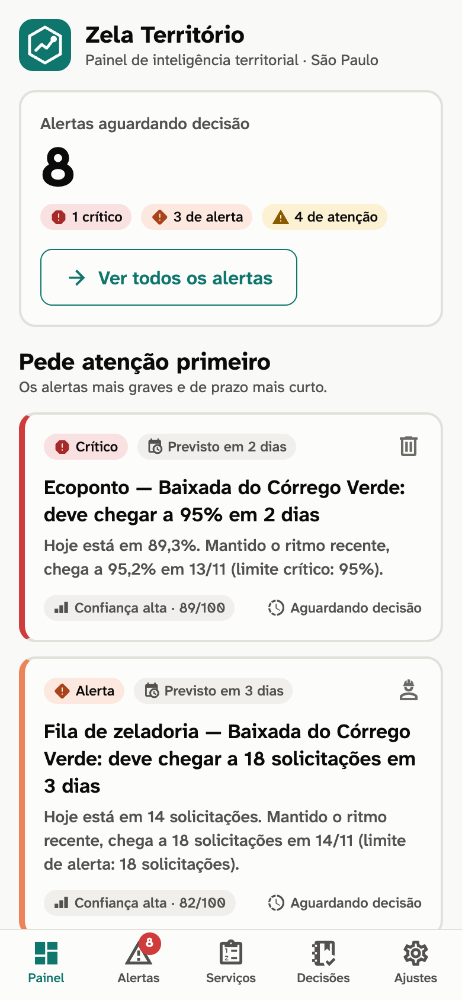
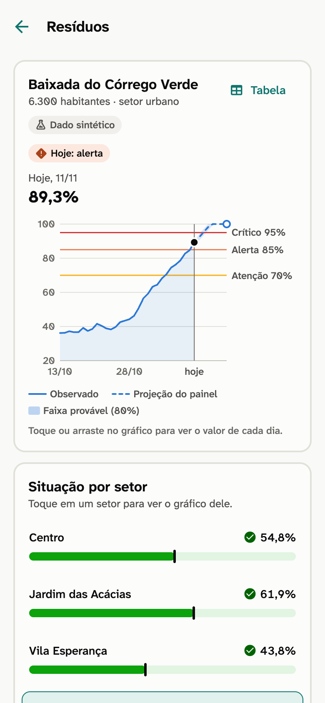
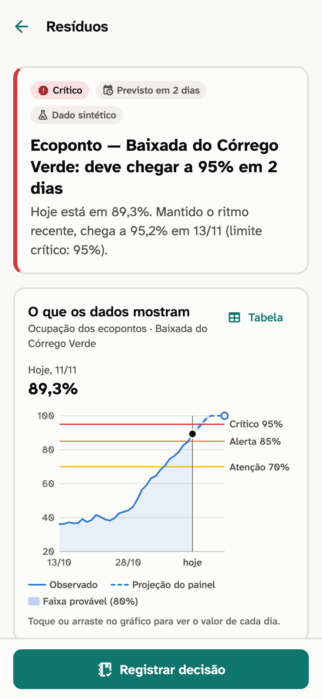
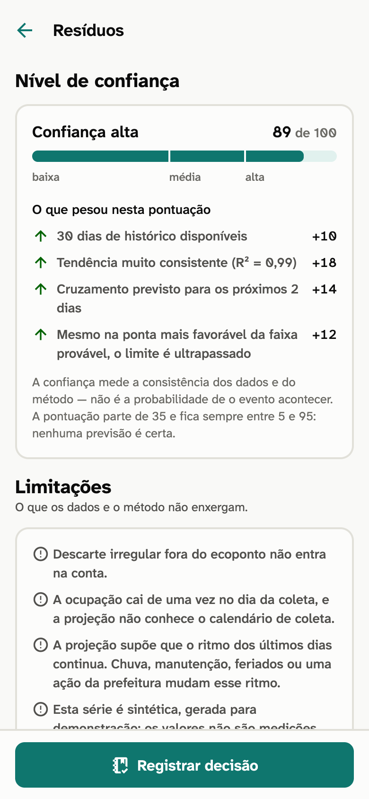
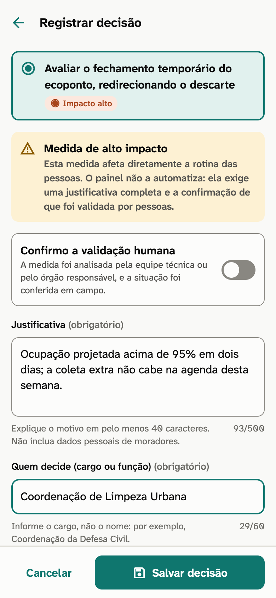
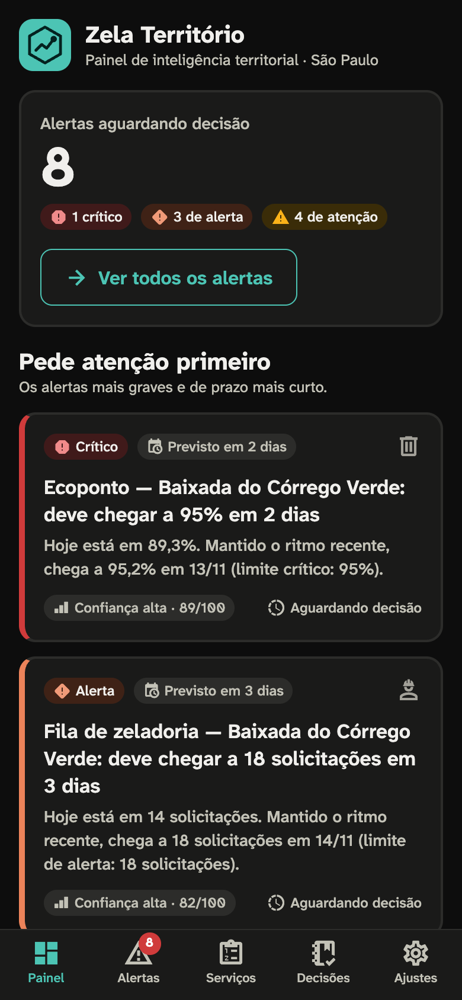

# Zela Território — Painel de Inteligência Territorial

Aplicativo mobile desenvolvido para a **Global Solution 2026.2 da FIAP** (desafio **CitizenTech**), disciplina **Cross-Platform Application Development**, 2º ano de Ciência da Computação — turma de fevereiro.

O Zela Território é a central de decisões de um gestor público: reúne indicadores do território, **antecipa problemas** com alertas preditivos explicados e **registra a decisão tomada por pessoas**. O aplicativo apoia a decisão; ele nunca decide nem executa medidas sozinho.

| | |
|---|---|
| **Integrantes** | Matheus Vilela Silveira — RM 564989<br>Maria Eduarda de Aquila Amaral — RM 563783<br>Daniel Castro Sanches — RM 563333 |
| **Stack** | React Native 0.88 + Expo SDK 58, TypeScript, Expo Router, Zustand, AsyncStorage, react-native-svg |
| **Plataformas** | Android e iOS (pelo Expo Go) e Web, com o mesmo código |
| **Dados** | Clima: API pública Open-Meteo (dados reais). Água, energia, resíduos e serviços: dados sintéticos de demonstração |

---

## Sumário

1. [O projeto](#1-o-projeto)
2. [Telas](#2-telas)
3. [Como executar](#3-como-executar)
4. [Requisitos do enunciado e onde estão no código](#4-requisitos-do-enunciado-e-onde-estão-no-código)
5. [Fontes de dados](#5-fontes-de-dados)
6. [Como os alertas preditivos funcionam](#6-como-os-alertas-preditivos-funcionam)
7. [Apoio à decisão sem automatizar decisões de alto impacto](#7-apoio-à-decisão-sem-automatizar-decisões-de-alto-impacto)
8. [Limitações](#8-limitações)
9. [Acessibilidade](#9-acessibilidade)
10. [Privacidade dos cidadãos](#10-privacidade-dos-cidadãos)
11. [Arquitetura e estrutura de pastas](#11-arquitetura-e-estrutura-de-pastas)
12. [Testes e qualidade](#12-testes-e-qualidade)
13. [Decisões da equipe](#13-decisões-da-equipe)

---

## 1. O projeto

### O problema

Quem administra um bairro, uma subprefeitura ou um município pequeno costuma descobrir os problemas **depois** que eles acontecem: o ecoponto transbordou, o reservatório baixou demais, a fila de solicitações de zeladoria dobrou, a chuva forte pegou todo mundo de surpresa. Os dados que permitiriam antecipar essas situações existem, mas ficam espalhados — e, quando chegam a um painel, vêm sem explicação: um número vermelho que não diz por que está vermelho, nem o quanto se pode confiar nele.

### Para quem

Um **gestor público** (subprefeitura, secretaria de serviços urbanos, coordenação de Defesa Civil) que precisa decidir onde colocar equipes e recursos nos próximos dias.

### O que o app faz

- **Painel** com o número de alertas que aguardam decisão e um cartão por tema: clima local, água, energia, resíduos e serviços urbanos.
- **Gráficos** de cada indicador: 30 dias de histórico, a projeção dos próximos 7 dias, a faixa provável e os limites de atenção, alerta e crítico. Dá para tocar no gráfico para ler cada dia e alternar para uma tabela com os mesmos valores.
- **Alertas preditivos** em que cada um traz a **justificativa**, o **nível de confiança** (com os fatores que pesaram), as **limitações** e as **opções de decisão** classificadas por impacto.
- **Registro de decisão**: o gestor escolhe o que fazer, justifica e informa o cargo. Medidas de alto impacto exigem justificativa maior e a confirmação de validação humana.
- **Diário de decisões**, com a fotografia do alerta no momento em que a decisão foi tomada.
- **Solicitações de zeladoria**: indicadores da fila, registro de novas solicitações e mudança de status.
- **Ajustes**: troca do território (busca de município em API pública), limites dos alertas por indicador, tema claro ou escuro, cenário sintético, privacidade e fontes de dados.

### Relação com o desafio CitizenTech e com os ODS

O desafio pede soluções que partam das necessidades reais das pessoas e usem "dados para decisões reais", antecipando problemas. O Zela Território ataca a ponta do gestor: transformar dados em avisos **antecipados, explicados e honestos sobre o que não sabem**.

| ODS | Como o projeto contribui |
|---|---|
| **11 — Cidades e comunidades sustentáveis** | Metas 11.5 (reduzir pessoas afetadas por desastres, inclusive os relacionados à água) e 11.b (planos de resiliência a desastres): alertas antecipados de chuva forte e calor. Meta 11.6 (gestão de resíduos): acompanhamento da ocupação dos ecopontos. |
| **13 — Ação contra a mudança global do clima** | Metas 13.1 (resiliência a riscos relacionados ao clima) e 13.3 (capacidade institucional de alerta precoce): o painel usa previsão meteorológica pública para avisar com dias de antecedência. |
| **9 — Indústria, inovação e infraestrutura** | Meta 9.1 (infraestrutura confiável e resiliente): acompanhamento da carga da rede elétrica e do abastecimento de água. |
| **10 — Redução das desigualdades** | O painel inclui setores rurais e periféricos, explicita que setores com menos acesso aos canais de atendimento registram menos solicitações (e não por terem menos problemas) e foi construído com acessibilidade. |

### Relação com os outros projetos da equipe

- **Zela Bairro** (Application Development): é o canal do cidadão. O Zela Território usa as mesmas categorias, prioridades e regras de "crítica" e "atrasada" nas solicitações de zeladoria.
- **Territory Predictive Insights** (POO): os dois métodos de previsão daquele projeto — tendência e média móvel — foram reimplementados aqui em TypeScript, com os mesmos princípios (por exemplo, não prever com poucas leituras).

Os três projetos compartilham conceitos e regras, mas **não trocam dados entre si**: este aplicativo funciona de forma independente.

---

## 2. Telas

| Painel | Detalhe de um tema | Alerta |
|:---:|:---:|:---:|
|  |  |  |

| Confiança e limitações | Decisão de alto impacto | Tema escuro |
|:---:|:---:|:---:|
|  |  |  |

As imagens foram capturadas da versão web do aplicativo, em tamanho de celular.

---

## 3. Como executar

### Pré-requisitos

- **Node.js** 22.13 ou mais recente (testado com o Node 26).
- Para rodar no celular: o aplicativo **Expo Go** (Android ou iOS) atualizado, com suporte ao **SDK 58**, e o celular na mesma rede Wi-Fi do computador.
- Internet para os dados de clima. Sem conexão, o app continua funcionando com os dados sintéticos e com a última previsão guardada.

### Passo a passo

```bash
# 1) Instalar as dependências
npm install

# 2) Iniciar o servidor de desenvolvimento
npx expo start
```

Com o servidor no ar:

- **Celular**: abra o Expo Go e leia o QR code que aparece no terminal.
- **Navegador**: pressione `w` no terminal (ou rode `npm run web`).
- **Rede que bloqueia a conexão entre celular e computador** (comum em redes de faculdade): use `npx expo start --tunnel`.

### Outros comandos

| Comando | O que faz |
|---|---|
| `npm test` | Roda os testes de regras e de componentes (Jest) |
| `npm run typecheck` | Verifica os tipos (TypeScript) |
| `npm run lint` | Verifica o código com o ESLint (regras do Expo) |
| `npm run format` | Formata o código com o Prettier |
| `npm run verificar` | Roda tipos, lint e testes em sequência |
| `npx expo export --platform web` | Gera a versão web estática na pasta `dist/` |

### Roteiro de demonstração sugerido

1. **Painel**: mostrar o número de alertas aguardando decisão e os cartões dos temas. Destacar os selos "Dado público" e "Dado sintético".
2. **Tema Resíduos**: abrir o gráfico da Baixada do Córrego Verde, tocar no gráfico para ler os dias, alternar para a tabela e tocar em outro setor na lista.
3. **Alerta crítico do ecoponto**: percorrer justificativa, confiança (com os fatores), limitações e opções por impacto.
4. **Registrar decisão**: tentar salvar vazio (erros), escolher a medida de alto impacto, mostrar a exigência de justificativa maior e de validação humana, salvar e ver a confirmação do que foi registrado.
5. **Diário de decisões**: mostrar o registro com a fotografia do alerta.
6. **Serviços**: registrar uma solicitação com um telefone na descrição (o formulário barra), corrigir, salvar e marcar como resolvida.
7. **Ajustes → Território**: buscar outro município e ver o clima mudar no painel.
8. **Ajustes → Limites dos alertas**: mudar um limite e ver os alertas recalculados.
9. **Tema Água → Sítio das Palmeiras**: mostrar o dado protegido pela regra de agregação mínima.
10. **Fechar e reabrir o app**: as decisões e solicitações continuam lá.

---

## 4. Requisitos do enunciado e onde estão no código

| Requisito | Onde está |
|---|---|
| **Flutter ou React Native** | React Native 0.88 com Expo SDK 58 e TypeScript. |
| **Navegação entre telas** | Expo Router: abas em [`src/app/(abas)/_layout.tsx`](src/app/%28abas%29/_layout.tsx) e pilha em [src/app/_layout.tsx](src/app/_layout.tsx), com rotas dinâmicas ([`tema/[tema].tsx`](src/app/tema/%5Btema%5D.tsx), [`alerta/[chave].tsx`](src/app/alerta/%5Bchave%5D.tsx), [`decisao/[chave].tsx`](src/app/decisao/%5Bchave%5D.tsx)) e passagem de parâmetros. São 14 telas. |
| **Gerenciamento de estado** | Quatro lojas Zustand em [src/estado/](src/estado/) (configurações, clima, solicitações e decisões) e hooks derivados em [src/estado/painel.ts](src/estado/painel.ts), que recalculam séries e alertas só quando uma entrada muda. |
| **Consumo de APIs** | [src/dados/openMeteo.ts](src/dados/openMeteo.ts): previsão do tempo e busca de municípios na API pública Open-Meteo, com tempo limite, tratamento de erros e validação da resposta. Estados de carregando, erro e "tentar de novo" nas telas. |
| **Persistência de dados** | Zustand `persist` + AsyncStorage ([src/estado/armazenamento.ts](src/estado/armazenamento.ts)): decisões, solicitações, limites, território, aparência e a última previsão do tempo sobrevivem ao fechamento do app. |
| **Formulários com validação** | Nova solicitação ([demanda/nova.tsx](src/app/demanda/nova.tsx)), registro de decisão ([`decisao/[chave].tsx`](src/app/decisao/%5Bchave%5D.tsx)), limites dos alertas ([limiares.tsx](src/app/limiares.tsx)) e busca de município ([territorio.tsx](src/app/territorio.tsx)). As regras ficam em [src/dominio/validacao.ts](src/dominio/validacao.ts), testadas sem interface. |
| **Componentes reutilizáveis com identidade visual própria** | [src/componentes/](src/componentes/): texto, botão, cartão, selos, campos de formulário, gráficos e cartões compostos, todos sobre os tokens de [src/tema/](src/tema/) (cores, espaçamento e tipografia). Símbolo e ícones do app próprios. |
| **Acessibilidade** | Ver a [seção 9](#9-acessibilidade). |
| **Privacidade dos cidadãos** | Ver a [seção 10](#10-privacidade-dos-cidadãos). |
| **Dashboards com gráficos e indicadores** | Painel ([`(abas)/index.tsx`](src/app/%28abas%29/index.tsx)), detalhe de tema e aba Serviços, com os gráficos de [src/componentes/graficos/](src/componentes/graficos/): série com projeção, colunas, minigráfico, barras ordenadas, medidores e barra segmentada. |
| **Alertas preditivos com justificativa, confiança e limitações** | Motor em [src/dominio/alertas.ts](src/dominio/alertas.ts), [src/dominio/previsao.ts](src/dominio/previsao.ts) e [src/dominio/confianca.ts](src/dominio/confianca.ts); tela em [`alerta/[chave].tsx`](src/app/alerta/%5Bchave%5D.tsx). |
| **Apoio à decisão sem automatizar decisões de alto impacto** | Opções por impacto em [src/dominio/recomendacoes.ts](src/dominio/recomendacoes.ts); regras do registro em [src/dominio/validacao.ts](src/dominio/validacao.ts) e [src/dominio/decisoes.ts](src/dominio/decisoes.ts). Ver a [seção 7](#7-apoio-à-decisão-sem-automatizar-decisões-de-alto-impacto). |

---

## 5. Fontes de dados

O enunciado permite dados públicos, sintéticos ou autorizados. O app usa os dois primeiros e **identifica a origem do dado** em cada cartão de tema, em cada gráfico e no detalhe de cada alerta.

### 5.1 Dado público: clima (Open-Meteo)

- **O que é**: [Open-Meteo](https://open-meteo.com) é uma API aberta de previsão do tempo, gratuita para uso não comercial, sem chave e sem cadastro. Os valores vêm de modelos meteorológicos de serviços nacionais de meteorologia, combinados pela Open-Meteo.
- **Previsão** — `GET https://api.open-meteo.com/v1/forecast`, com `daily=precipitation_sum,precipitation_probability_max,apparent_temperature_max,temperature_2m_max,temperature_2m_min`, `past_days=14`, `forecast_days=7` e `timezone=auto`. Uma única chamada traz 14 dias passados e 7 dias previstos.
- **Busca de municípios** — `GET https://geocoding-api.open-meteo.com/v1/search`, com `countryCode=BR` e `language=pt`.
- **Licença**: [CC BY 4.0](https://open-meteo.com/en/license). Atribuição: *Weather data by Open-Meteo.com*.
- **O que é enviado**: apenas a coordenada do município escolhido, arredondada para duas casas (cerca de 1 km), e o nome digitado na busca.

### 5.2 Dados sintéticos: água, energia, resíduos e serviços

Dados reais de consumo de água, carga da rede elétrica e ocupação de ecopontos pertencem a concessionárias e prefeituras e só poderiam ser usados com autorização. Por isso essas séries são **geradas pelo próprio aplicativo** ([src/dados/sintetico.ts](src/dados/sintetico.ts)):

- cada setor tem um perfil por indicador (valor de hoje, variação por dia e ruído);
- o ruído é determinístico (sem `Math.random`): abrir o app de novo mostra os mesmos números;
- o cenário é **ancorado na data de hoje**: a demonstração é idêntica em qualquer dia, só as datas mudam;
- em Ajustes é possível gerar outro cenário, o que redistribui os perfis entre os setores e mostra que os alertas reagem aos dados, não a um roteiro fixo.

Os **setores são fictícios** (Centro, Jardim das Acácias, Vila Esperança, Baixada do Córrego Verde, Núcleo Rural Ribeirão Claro e Sítio das Palmeiras). Foi uma escolha deliberada: números sintéticos com nomes de bairros reais poderiam passar a impressão de descrever lugares de verdade.

### 5.3 Solicitações de zeladoria

A fila soma solicitações sintéticas com as **registradas no próprio aparelho**. As registradas ficam salvas localmente e entram na hora nos indicadores e nos alertas do tema Serviços urbanos.

### 5.4 Indicadores

| Tema | Indicador | Unidade | Origem | Limites padrão (atenção / alerta / crítico) |
|---|---|---|---|---|
| Clima local | Chuva acumulada em 24 horas | mm | Pública | a partir de 30 / 50 / 100 |
| Clima local | Sensação térmica máxima | °C | Pública | a partir de 32 / 36 / 40 |
| Água | Nível do reservatório | % | Sintética | até 50 / 35 / 20 |
| Água | Consumo de água por habitante | L/hab/dia | Sintética | a partir de 160 / 180 / 200 |
| Energia | Carga da rede elétrica no pico | % | Sintética | a partir de 80 / 90 / 100 |
| Resíduos | Ocupação dos ecopontos | % | Sintética | a partir de 70 / 85 / 95 |
| Serviços urbanos | Solicitações em aberto | quantidade | Sintética + registros do app | a partir de 12 / 18 / 25 |

Os limites de alerta e crítico da chuva seguem as faixas dos avisos de chuvas intensas do [INMET](https://avisos.inmet.gov.br/) (de 50 a 100 mm por dia e acima de 100 mm por dia). Os demais são pontos de partida definidos pela equipe. Todos podem ser alterados em **Ajustes → Limites dos alertas**, porque quem conhece o território é quem deve calibrar o painel.

---

## 6. Como os alertas preditivos funcionam

### 6.1 De onde vem a previsão

| Situação | Método | Por quê |
|---|---|---|
| Clima | **Previsão do modelo meteorológico** (Open-Meteo). O app não projeta nada. | Já existe uma previsão especializada; refazê-la com uma reta seria pior. |
| Demais indicadores, com tendência consistente | **Tendência**: reta ajustada por mínimos quadrados aos últimos 14 dias, prolongada por 7 dias. | Simples, explicável e suficiente para "se o ritmo continuar, em quantos dias cruza o limite?". |
| Demais indicadores, sem tendência consistente (R² abaixo de 0,3) | **Média móvel** dos últimos 7 dias, repetida para frente. | Extrapolar uma inclinação que os dados não sustentam seria inventar um padrão. |
| Menos de 7 leituras | **Nenhuma previsão, nenhum alerta.** | O painel prefere se calar a "chutar com cara de número". |

A **faixa provável** exibida nos gráficos é o intervalo de previsão de 80% da regressão; ela se alarga quanto mais distante é o dia projetado.

### 6.2 O que todo alerta traz

1. **Nível** (atenção, alerta ou crítico) e **prazo** — "previsto em 3 dias" ou "em curso".
2. **Justificativa**, com os números: leitura atual, método e ajuste (variação por dia e R²), valor projetado com a faixa provável e o limite configurado. No clima, entram a probabilidade de chuva e a chuva acumulada nos três dias anteriores (solo encharcado aumenta o risco).
3. **Nível de confiança**, com os fatores que somaram ou tiraram pontos.
4. **Limitações**: as do indicador, as do método e, quando for o caso, o aviso de que a série é sintética.
5. **Opções de decisão**, classificadas por impacto na população.

### 6.3 Nível de confiança

A confiança é uma pontuação transparente ([src/dominio/confianca.ts](src/dominio/confianca.ts)): parte de **35** e cada fator soma ou subtrai pontos. O resultado fica sempre entre **5 e 95** — nenhuma previsão é certa. Até 44 a confiança é **baixa**; de 45 a 69, **média**; de 70 em diante, **alta**.

| Fator (alertas calculados pelo app) | Efeito |
|---|---|
| Histórico disponível: 28 dias ou mais / de 14 a 27 / menos de 14 | +10 / +4 / −12 |
| Tendência (R²): 0,8 ou mais / de 0,6 a 0,8 / abaixo de 0,6 | +18 / +10 / +2 |
| Sem tendência, variação dos valores: até 5% / até 10% / acima disso | +10 / +4 / −8 |
| Prazo: limite já ultrapassado / em até 2 dias / em 3 ou 4 dias / em 5 dias ou mais | +18 / +14 / +7 / −5 |
| Limite ultrapassado mesmo na ponta favorável da faixa provável: sim / não | +12 / −8 |

| Fator (alertas de clima) | Efeito |
|---|---|
| Prazo da previsão: até 48 horas / 2 a 3 dias / 4 a 5 dias / 6 dias ou mais | +25 / +12 / 0 / −10 |
| Probabilidade de chuva: 80% ou mais / 60 a 79% / 40 a 59% / abaixo de 40% | +20 / +10 / 0 / −12 |
| Valor previsto: 25% ou mais acima do limite / menos de 10% acima | +10 / −8 |
| Calor: dois ou mais dias seguidos acima do limite | +8 |

A tela de cada alerta mostra exatamente quais fatores entraram e com quantos pontos. A confiança mede **a consistência dos dados e do método**; não é a probabilidade de o evento acontecer, e o app diz isso na tela.

---

## 7. Apoio à decisão sem automatizar decisões de alto impacto

O princípio do enunciado virou regra de interface e de código:

- **O app não executa nada.** Não há botão que acione equipes, interdite vias ou mude o abastecimento. O que existe é o registro do que **pessoas** decidiram.
- **Opções, não ordens.** Cada alerta apresenta várias opções, com o impacto estimado (baixo, médio ou alto). O gestor também pode adotar outra medida, apenas monitorar ou descartar o alerta.
- **Medidas de alto impacto** (abrir abrigos, interditar vias, rodízio de abastecimento, fechar um ecoponto) só podem ser registradas com:
  - justificativa de pelo menos 40 caracteres (o dobro das demais);
  - a confirmação explícita de que a medida foi **validada pela equipe técnica ou pelo órgão responsável** e de que a situação foi conferida em campo.
- **Toda decisão exige justificativa e o cargo de quem decide**, e fica no diário com a fotografia do alerta: título, nível e confiança no momento. Ao salvar, a tela mostra exatamente o que foi registrado.
- **Os limites são do gestor**, não do aplicativo: limites mais baixos avisam antes e geram mais alarmes falsos; mais altos, o contrário. Essa é uma decisão de gestão.

---

## 8. Limitações

**Dos dados**

- Os dados de água, energia, resíduos e serviços são **sintéticos**. Eles demonstram o funcionamento do painel, mas não validam o método: com dados reais, os limites e as regras precisariam ser recalibrados.
- A previsão do tempo vale para **um ponto de grade** de alguns quilômetros no centro do município. Pancadas localizadas podem não aparecer, e diferenças entre bairros não são captadas.
- O risco de alagamento depende de drenagem, relevo e ocupação do solo, que o painel não mede.
- A fila de solicitações conta **o que foi registrado**: problemas não relatados ficam invisíveis, e setores com menos acesso aos canais de atendimento tendem a aparecer menos.

**Do método**

- A tendência é uma **reta**: descreve o ritmo recente, não explica por que ele existe nem quando vai mudar. Eventos como chuva, feriado, manutenção ou uma ação da prefeitura quebram o padrão.
- A média móvel repete a média recente e **não antecipa mudanças bruscas**.
- A projeção da ocupação dos ecopontos não conhece o calendário de coleta, que zera a ocupação de uma vez.
- Os pesos da pontuação de confiança foram **definidos pela equipe**, não estimados a partir de acertos e erros passados.

**Do aplicativo**

- Tudo fica **no aparelho**: não há servidor, login nem sincronização entre aparelhos ou entre membros de uma equipe.
- Não há notificações: os alertas são recalculados quando o app é aberto ou atualizado.
- O detector de dados pessoais reconhece CPF, telefone e e-mail por padrões de texto; **não reconhece nomes** e pode deixar passar formatos incomuns.
- O painel **não substitui** vistoria em campo nem os avisos oficiais da Defesa Civil, do INMET e do CEMADEN.

---

## 9. Acessibilidade

- **Cor nunca é a única pista.** Cada situação tem um ícone de formato próprio e o nome escrito: círculo com visto (normal), triângulo (atenção), losango (alerta) e octógono (crítico). No gráfico, o observado é linha cheia e a projeção é tracejada.
- **Contraste conferido por cálculo**: todos os textos dos dois temas atendem ao WCAG AA (pelo menos 4,5:1 sobre o fundo em que aparecem). O amarelo e o laranja de situação têm contraste baixo sobre fundo claro; por isso nunca carregam a informação sozinhos — vêm sempre com ícone, rótulo e valor escrito, e os medidores têm um marcador escuro no fim da barra. As cores das séries dos gráficos foram validadas para daltonismo (protanopia e deuteranopia).
- **Leitores de tela (TalkBack e VoiceOver)**: os controles têm papel, rótulo e estado; cartões são lidos como uma frase única; erros de formulário são anunciados; ícones decorativos ficam ocultos.
- **Gráficos acessíveis**: cada gráfico tem uma descrição em texto, uma **tabela equivalente** com todos os valores e, no celular, permite percorrer os dias com o gesto de ajuste do leitor de tela. O valor do dia fica sempre visível, sem depender do toque.
- **Tipografia** Atkinson Hyperlegible Next, criada pelo Braille Institute para leitores com baixa visão, com letras e números difíceis de confundir (0 e O; 1, l e I).
- **Tamanho de fonte do sistema** respeitado, com limite de ampliação apenas nos títulos grandes para não quebrar o layout.
- **Áreas de toque** de pelo menos 44 a 48 pontos.
- **Formulários** com rótulo visível em todos os campos, texto de ajuda, mensagem de erro em texto e resumo dos erros no topo.
- **Tema claro e escuro**, seguindo o sistema ou a escolha do usuário.

---

## 10. Privacidade dos cidadãos

O painel foi desenhado para decidir sobre o território **sem precisar saber quem são as pessoas** ([src/dominio/privacidade.ts](src/dominio/privacidade.ts)):

- **Somente dados agregados** por setor — nunca por pessoa, domicílio ou endereço.
- **Agregação mínima**: o consumo de água por habitante não é exibido nem projetado em setores com menos de 50 domicílios, onde a média poderia revelar hábitos de famílias identificáveis. O setor Sítio das Palmeiras existe para demonstrar a regra.
- **Formulários sem dados pessoais**: não há campo de nome, contato ou endereço; a localização é registrada só por setor; os textos livres são verificados para barrar CPF, telefone e e-mail.
- **Decisões por cargo**: o diário guarda a função de quem decidiu, não o nome.
- **Nenhuma permissão do aparelho**: o app não usa GPS, câmera, contatos nem notificações.
- **O que sai do aparelho**: apenas a coordenada arredondada do município e o nome digitado na busca, ambos enviados à Open-Meteo. Não há analytics, anúncios nem rastreadores.
- **Transparência e controle**: a tela Privacidade e dados mostra o que está guardado e permite apagar tudo.

Em um uso real, com dados de concessionárias e da prefeitura, o tratamento teria de seguir a LGPD: base legal definida, dados mínimos, acesso controlado e registro de consultas.

---

## 11. Arquitetura e estrutura de pastas

O código é separado em camadas, e as regras de negócio não dependem de interface: `dominio` e `dados` são funções puras, testadas sem montar telas.

```
zela-territorio/
├── app.json                 # nome, ícones, tela de abertura e plugins do Expo
├── package.json             # dependências e scripts
├── assets/images/           # ícones e imagem de abertura do app
├── docs/telas/              # capturas de tela usadas neste README
└── src/
    ├── app/                 # ROTAS (Expo Router): cada arquivo é uma tela
    │   ├── _layout.tsx          # pilha raiz: fontes, dados salvos, tema e clima
    │   ├── (abas)/              # barra de abas
    │   │   ├── _layout.tsx
    │   │   ├── index.tsx            # Painel
    │   │   ├── alertas.tsx          # lista de alertas
    │   │   ├── demandas.tsx         # solicitações de zeladoria
    │   │   ├── decisoes.tsx         # diário de decisões
    │   │   └── ajustes.tsx
    │   ├── tema/[tema].tsx      # gráficos e setores de um tema
    │   ├── alerta/[chave].tsx   # detalhe de um alerta
    │   ├── decisao/[chave].tsx  # formulário de decisão
    │   ├── demanda/nova.tsx     # formulário de solicitação
    │   ├── territorio.tsx       # busca de município (API)
    │   ├── limiares.tsx         # limites dos alertas
    │   ├── privacidade.tsx
    │   ├── fontes.tsx           # fontes de dados e limitações
    │   └── +not-found.tsx
    ├── componentes/         # INTERFACE reutilizável
    │   ├── Texto, Botao, Cartao, Icone, Selos, Blocos, Formulario, Tela, Marca
    │   ├── CartaoAlerta, CartaoTema, CartaoDemanda, CartaoDecisao
    │   └── graficos/            # GraficoSerie, MiniGrafico, Marcas, CartaoGrafico, escala
    ├── tema/                # tokens de design: cores, medidas, tipografia
    ├── dominio/             # REGRAS puras
    │   ├── tipos.ts             # tipos do domínio
    │   ├── previsao.ts          # tendência, média móvel e faixa provável
    │   ├── limiares.ts          # classificação e validação dos limites
    │   ├── alertas.ts           # motor de alertas (justificativa e limitações)
    │   ├── confianca.ts         # pontuação de confiança
    │   ├── recomendacoes.ts     # opções de decisão por impacto
    │   ├── decisoes.ts          # montagem do registro de decisão
    │   ├── validacao.ts         # regras dos formulários
    │   └── privacidade.ts       # dados pessoais, agregação mínima, coordenadas
    ├── dados/               # FONTES de dados
    │   ├── catalogo.ts          # temas, setores e indicadores
    │   ├── openMeteo.ts         # cliente da API pública
    │   ├── sintetico.ts         # gerador de dados sintéticos
    │   ├── demandas.ts          # indicadores da fila de solicitações
    │   └── painel.ts            # junta tudo: séries e alertas
    ├── estado/              # ESTADO global (Zustand) e persistência
    │   ├── armazenamento.ts     # AsyncStorage
    │   ├── configuracoes.ts, clima.ts, demandas.ts, decisoes.ts
    │   └── painel.ts            # hooks derivados (usePainel, useDemandas…)
    └── utils/               # datas e números no padrão brasileiro; ajuda de navegação
```

Os testes ficam em pastas `__tests__`, ao lado do código que testam. O teste que percorre o app inteiro fica em `src/__tests__/telas.test.tsx`.

**Fluxo dos dados**

```
Open-Meteo (API) ──► loja clima ─────────┐
gerador sintético ───────────────────────┤
solicitações (loja + sintéticas) ────────┼─► montarPainel() ─► séries + alertas ─► telas
limites e cenário (loja configurações) ──┘                           │
                                                                     ▼
                                        decisão registrada ─► loja decisões ─► AsyncStorage
```

As telas não guardam cópias dos dados: leem as lojas pelos hooks de [src/estado/painel.ts](src/estado/painel.ts). Quando o gestor muda um limite, registra uma solicitação ou troca o território, o painel inteiro é recalculado a partir das mesmas funções puras.

---

## 12. Testes e qualidade

`npm test` roda **218 testes** em 18 arquivos (Jest com o preset do Expo e React Native Testing Library):

| Arquivo de teste | O que prova |
|---|---|
| `__tests__/telas.test.tsx` | **Testes das telas**: monta as rotas reais do app com o utilitário de testes do Expo Router, no ambiente nativo do Jest, com a API pública substituída por respostas fixas. Todas as telas abrem sem erro (17 endereços, contando os cinco temas); endereços inválidos caem em telas de aviso; o painel funciona sem conexão; o fluxo alerta → decisão de alto impacto (bloqueada sem validação humana) → diário; a nova solicitação (bloqueada com telefone no texto); a busca de município (validação, resultado, erro da API, troca de território e nova consulta do clima); os limites dos alertas (ordem, número inválido, salvar, restaurar); a tabela do gráfico e a troca de setor (com o indicador sensível oculto); apagar os dados. |
| `dominio/previsao.test.ts` | Média, desvio, regressão em reta perfeita, escolha entre tendência e média móvel, faixa que se alarga, limites físicos, silêncio com poucas leituras. |
| `dominio/limiares.test.ts` | Classificação nos dois sentidos, inclusive nas bordas; validação de ordem e faixa. |
| `dominio/confianca.test.ts` | Pontuação igual à base mais os fatores exibidos; casos de confiança alta, média e baixa; nunca 0 nem 100. |
| `dominio/alertas.test.ts` | Alerta previsto e em curso, textos, justificativa com quatro itens, limitações, opções por nível, clima (probabilidade, chuva antecedente, dias seguidos), ordenação. |
| `dominio/decisoes.test.ts` | Fotografia do alerta; validação humana só em alto impacto. |
| `dominio/validacao.test.ts` | Regras dos quatro formulários, inclusive o bloqueio de dados pessoais e as exigências de alto impacto. |
| `dominio/privacidade.test.ts` | Dígitos verificadores do CPF, telefones em vários formatos, falsos positivos evitados, agregação mínima, arredondamento de coordenadas. |
| `dados/sintetico.test.ts` | Gerador determinístico, valores dentro da faixa, cenário ancorado em hoje, nenhum dado pessoal gerado. |
| `dados/painel.test.ts` | **Contrato da demonstração**: o cenário padrão produz exatamente os alertas esperados, em qualquer data; efeito de novas solicitações e de limites personalizados. |
| `dados/demandas.test.ts` | Fila por dia, regras de crítica e atrasada, resumo. |
| `dados/openMeteo.test.ts` | URLs, interpretação da resposta real, fuso horário, erros de rede, tempo esgotado, servidor e formato. |
| `estado/lojas.test.ts` | Ações das lojas, persistência e recarga, loja do clima em sucesso, erro, troca de território e respostas fora de ordem. |
| `componentes/graficos/escala.test.ts` | Eixos com marcas redondas, limites visíveis, rótulos sem sobreposição. |
| `componentes/Tela.test.tsx` | **Moldura das telas no celular**: a faixa da barra de status fica fora da rolagem nas abas; o indicador de puxar para atualizar só gira quando a pessoa puxou; o rodapé dos formulários encosta no teclado aberto. |
| `componentes/graficos/GraficoSerie.test.tsx` | **Gráfico no celular**: leitura para leitor de tela (gesto de ajustar, dia a dia), toque e arrasto, e a seleção preservada quando os dados mudam. |
| `componentes/Formulario.test.tsx` | **Testes de componente**: campo de texto (rótulo, ajuda, erro, contador), seletores, interruptor e botões — o que aparece na tela e o que o leitor de tela recebe (marcado, desabilitado, ocupado). |
| `utils/formatacao.test.ts` | Datas e números no padrão brasileiro. |

Além dos testes: TypeScript em modo estrito (`npm run typecheck`), ESLint com as regras do Expo (`npm run lint`) e Prettier (`npm run format`).

---

## 13. Decisões da equipe

- **React Native com Expo**, e não Flutter: a equipe já trabalha com JavaScript no Zela Bairro, e o Expo Go permite demonstrar em qualquer celular sem compilar o app.
- **Expo Router**: navegação baseada em arquivos, com rotas dinâmicas e parâmetros tipados.
- **Zustand** para o estado global: menos código que o Redux e sem as renderizações em cascata de um Context grande; o `persist` resolve a persistência no mesmo lugar.
- **Gráficos próprios com react-native-svg**, sem biblioteca de gráficos: controle total da identidade visual e da acessibilidade (descrição, tabela equivalente, leitura por toque) e nenhuma dependência nativa fora do Expo Go.
- **Regras puras fora das telas**: previsão, alertas, confiança, validação e privacidade são funções sem interface. É o que permite testá-las e explicá-las.
- **Azul para dados, cores reservadas para situação**: as séries dos gráficos são azuis para nunca se confundirem com verde, amarelo, laranja e vermelho, que significam apenas situação.
- **Setores fictícios** para os dados sintéticos e **cenário ancorado em hoje**, para a demonstração ser reprodutível.
- **Confiança como soma de fatores visíveis**, em vez de um número "mágico": o gestor vê por que confiar ou desconfiar.
- **Formulários em telas próprias**, com os botões fixos no rodapé e confirmação de exclusão na própria tela, para o comportamento ser o mesmo em Android, iOS e web.
